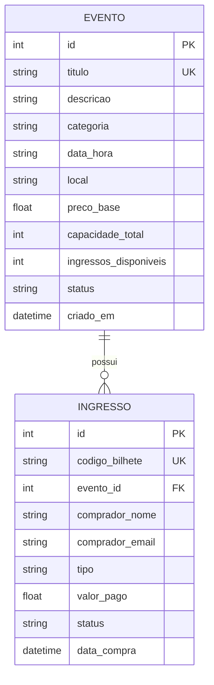

# Trabalho Prático 2 - APIs RESTful com Flask, Connexion, SQLAlchemy e Marshmallow

Este repositório contém a resolução completa das duas etapas solicitadas:
1. **Implementação passo a passo do tutorial Real Python:**
   - **1ª Parte**: Construção de uma API REST com Flask, Connexion e especificação OpenAPI 3.0 / Swagger UI (armazenamento em memória).
   - **2ª Parte**: Refatoração e integração com banco de dados relacional SQLite, mapeamento objeto-relacional (ORM) com Flask-SQLAlchemy e serialização/validação com Flask-Marshmallow.
2. **Desenvolvimento de solução para uma Situação-Problema prática:**
   - **EventPass API**: Sistema de Divulgação e Venda de Ingressos de Eventos Online com controle de capacidade, regras de precificação dinâmica (Inteira, Meia-Entrada 50%, VIP 150%), emissão e cancelamento de bilhetes e painel web interativo.

---

## 📁 Estrutura do Repositório

```text
trabalho2/
│
├── requirements.txt              # Dependências do projeto
├── README.md                     # Documentação completa
│
├── parte1_tutorial/              # ITEM 1 - 1ª PARTE DO TUTORIAL (Em Memória)
│   ├── app.py                    # Aplicação Flask + Connexion
│   ├── people.py                 # Funções de CRUD da API em memória
│   ├── swagger.yml               # Especificação OpenAPI 3.0 (Contrato da API)
│   └── templates/
│       └── home.html             # Interface web inicial
│
├── parte2_tutorial/              # ITEM 1 - 2ª PARTE DO TUTORIAL (SQLite + Marshmallow)
│   ├── app.py                    # Aplicação Flask + Connexion integrada ao SQLite
│   ├── config.py                 # Configuração de Connexion, SQLAlchemy e Marshmallow
│   ├── models.py                 # Modelo Person e PersonSchema (AutoSchema)
│   ├── people.py                 # CRUD persistido com SQLAlchemy Session
│   ├── build_database.py         # Script de criação e seed do banco people.db
│   ├── people.db                 # Banco de dados SQLite gerado
│   ├── swagger.yml               # Especificação OpenAPI 3.0
│   └── templates/
│       └── home.html             # Interface web exibindo dados do banco SQLite
│
└── solucao_problema/             # ITEM 2 - SITUAÇÃO-PROBLEMA (EventPass API)
    ├── app.py                    # Ponto de entrada da aplicação e rotas
    ├── config.py                 # Configurações do ecossistema
    ├── models.py                 # Modelos relacionais (Evento, Ingresso) e Schemas
    ├── eventos.py                # Handlers de divulgação e gestão de eventos
    ├── ingressos.py              # Handlers de venda, emissão e cancelamento de ingressos
    ├── build_database.py         # Script de criação e seed do banco eventos.db
    ├── eventos.db                # Banco de dados SQLite do EventPass
    ├── swagger.yml               # Especificação OpenAPI 3.0 completa dos eventos e vendas
    └── templates/
        └── index.html            # Dashboard web moderno, responsivo e interativo
```

---

## ⚙️ Tecnologias Utilizadas

- **Python 3.14+**
- **Flask 3.1+**: Microframework web para Python.
- **Connexion 3.3+**: Framework sobre o Flask que automatiza o roteamento, a validação de parâmetros e requisições HTTP a partir de um contrato **OpenAPI 3.0 / Swagger**, fornecendo documentação viva interativa.
- **Flask-SQLAlchemy 3.1+ & SQLAlchemy 2.1+**: ORM moderno para manipulação de bancos de dados relacionais com Python.
- **Flask-Marshmallow 1.5+ & Marshmallow-SQLAlchemy 1.6+**: Serialização e desserialização de objetos Python/SQLAlchemy para JSON com validação de dados.
- **SQLite 3**: Banco de dados relacional embarcado e persistente.
- **Swagger UI Bundle**: Interface gráfica para explorar e testar interativamente todos os endpoints REST via navegador.
- **HTML5 & Vanilla CSS**: Interface web com design moderno em Dark Mode e Glassmorphism.

---

## 🚀 Instalação e Preparação do Ambiente

### 1. Criar e Ativar o Ambiente Virtual (`venv`)
No terminal (PowerShell ou Prompt de Comando) na raiz do projeto:

```powershell
python -m venv venv
.\venv\Scripts\activate
```

### 2. Instalar as Dependências
```powershell
python -m pip install --upgrade pip
pip install -r requirements.txt
```


---

## 📖 1) Tutorial Real Python - Passo a Passo

### 1ª Parte: Flask + Connexion com Armazenamento em Memória (`parte1_tutorial/`)

#### O que foi implementado:
- Configuração do `connexion.App` associando o arquivo de contrato `swagger.yml`.
- Dicionário em memória `PEOPLE` contendo dados de teste com timestamps.
- Funções CRUD mapeadas pelo `operationId` do Swagger:
  - `people.read_all`: `GET /api/people`
  - `people.create`: `POST /api/people`
  - `people.read_one`: `GET /api/people/{lname}`
  - `people.update`: `PUT /api/people/{lname}`
  - `people.delete`: `DELETE /api/people/{lname}`
- Tratamento de status HTTP apropriados com `abort(404)` e `abort(406)`.

#### Como Executar:
```powershell
cd parte1_tutorial
python app.py
```
- **Página Inicial:** [http://127.0.0.1:8000](http://127.0.0.1:8000)
- **Swagger UI Interativo:** [http://127.0.0.1:8000/api/ui](http://127.0.0.1:8000/api/ui)
- **Endpoint JSON:** [http://127.0.0.1:8000/api/people](http://127.0.0.1:8000/api/people)


---

### 2ª Parte: Integração com Banco SQLite, SQLAlchemy e Marshmallow (`parte2_tutorial/`)

#### O que foi implementado:
- Modularização da arquitetura em `config.py` e `models.py`.
- Modelo ORM `Person(db.Model)` com chave primária autoincrementada `id`, `lname` único, `fname` e `timestamp`.
- Serialização via `PersonSchema(ma.SQLAlchemyAutoSchema)` garantindo conversão transparente entre instâncias SQLAlchemy e dicionários JSON.
- Substituição da manipulação em memória pelas consultas e transações de sessão do SQLAlchemy (`db.session.add()`, `db.session.merge()`, `db.session.delete()`, `db.session.commit()`).
- Script de inicialização e seed do banco `build_database.py`.

#### Como Inicializar e Executar:
```powershell
# 1. Gerar e popular o banco de dados SQLite (people.db)
python parte2_tutorial/build_database.py

# 2. Iniciar o servidor
cd parte2_tutorial
python app.py
```
- **Página Inicial (Lista dinâmica do SQLite):** [http://127.0.0.1:8000](http://127.0.0.1:8000)
- **Swagger UI:** [http://127.0.0.1:8000/api/ui](http://127.0.0.1:8000/api/ui)
- **Endpoint JSON:** [http://127.0.0.1:8000/api/people](http://127.0.0.1:8000/api/people)


---

## 🎟️ 2) Situação-Problema: EventPass API (Divulgação & Venda de Ingressos Online)

### Contexto e Justificativa da Escolha
A venda e divulgação de eventos online é um dos cenários mais ricos em regras de negócio e controle de concorrência em sistemas distribuídos e APIs web. A aplicação desenvolvida resolve os seguintes problemas:
1. **Divulgação de Atrações Culturais/Acadêmicas**: Permite consultar eventos por categoria (Shows, Congressos, Teatro, Workshops) com detalhes de local, data/hora e preços.
2. **Controle de Lotação e Vagas em Tempo Real**: Evita overbooking através do controle atômico do estoque de vagas (`ingressos_disponiveis` vs `capacidade_total`).
3. **Regras de Negócio e Precificação Flexível**:
   - `INTEIRA`: 100% do preço base do evento.
   - `MEIA`: 50% de desconto para estudantes/professores/idosos.
   - `VIP`: 150% do valor base com direito a credenciamento especial.
4. **Emissão de Bilhete com Código Único**: Cada compra gera um código identificador exclusivo (ex: `TKT-XXXXXXXX`).
5. **Cancelamento e Devolução de Vagas**: O comprador pode consultar o bilhete e solicitar o cancelamento, estornando o valor e devolvendo imediatamente a vaga ao estoque do evento (se o evento estava "ESGOTADO", ele retorna automaticamente para o status "ATIVO").

### Modelagem do Banco de Dados Relacional (`solucao_problema/models.py`)



### Endpoints da API REST (`solucao_problema/swagger.yml`)

| Método | Rota | Descrição |
|---|---|---|
| `GET` | `/api/eventos` | Lista eventos (filtros opcionais por `categoria` e `status`) |
| `POST` | `/api/eventos` | Cadastra novo evento com validação de unicidade de título |
| `GET` | `/api/eventos/{evento_id}` | Detalhes e disponibilidade de um evento |
| `PUT` | `/api/eventos/{evento_id}` | Atualiza informações cadastrais do evento |
| `DELETE` | `/api/eventos/{evento_id}` | Exclui o evento e seus ingressos em cascata |
| `POST` | `/api/ingressos/compra` | Efetua a compra de ingresso (Inteira, Meia, VIP) |
| `GET` | `/api/ingressos` | Lista todos os bilhetes (filtro opcional por `email`) |
| `GET` | `/api/ingressos/{codigo_bilhete}` | Consulta autenticidade e detalhes de um bilhete |
| `POST` | `/api/ingressos/{codigo_bilhete}/cancelar` | Cancela ingresso, estorna valor e restitui vaga ao evento |

### Como Executar o EventPass:
```powershell
# 1. Inicializar e popular o banco de dados (eventos.db)
python solucao_problema/build_database.py

# 2. Iniciar a API e o Painel Web
cd solucao_problema
python app.py
```

Acessar no navegador:
- 🌐 **Painel Web Completo:** [http://127.0.0.1:8000](http://127.0.0.1:8000)
  - Visualize os cartões de eventos com barras de progresso de lotação.
  - Compre ingressos em tempo real com modal dinâmico que calcula preços de Meia e VIP.
  - Receba o comprovante e código do bilhete emitido.
  - Consulte e cancele bilhetes com devolução instantânea de vaga.
  - Cadastre novos eventos pelo formulário.
- ⚡ **Documentação Swagger UI:** [http://127.0.0.1:8000/api/ui](http://127.0.0.1:8000/api/ui)

